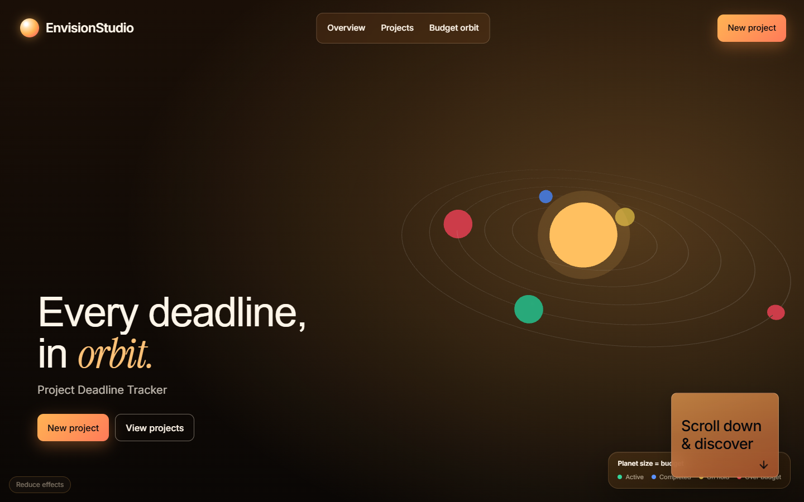
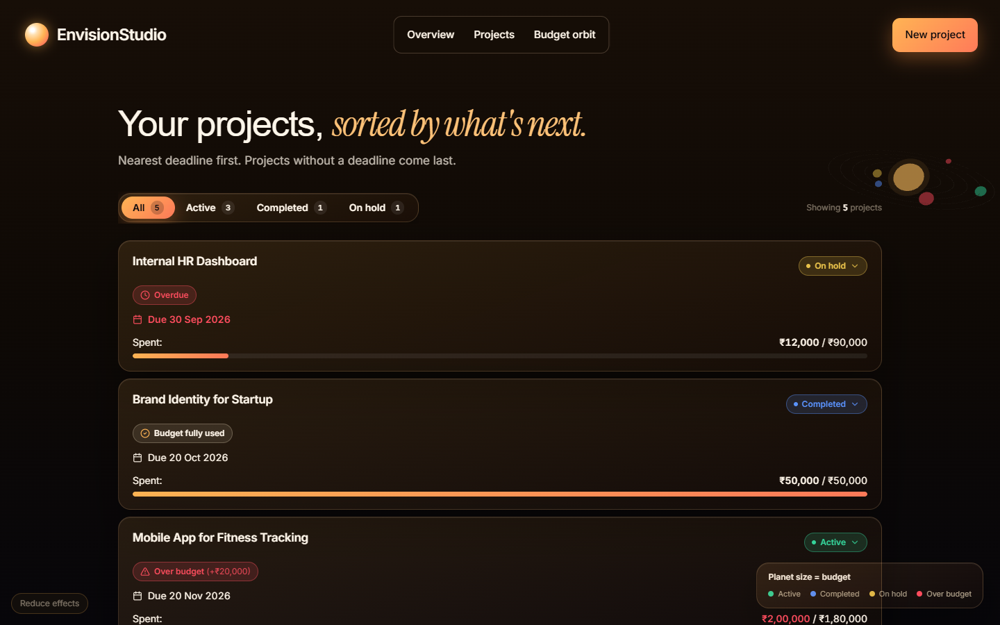
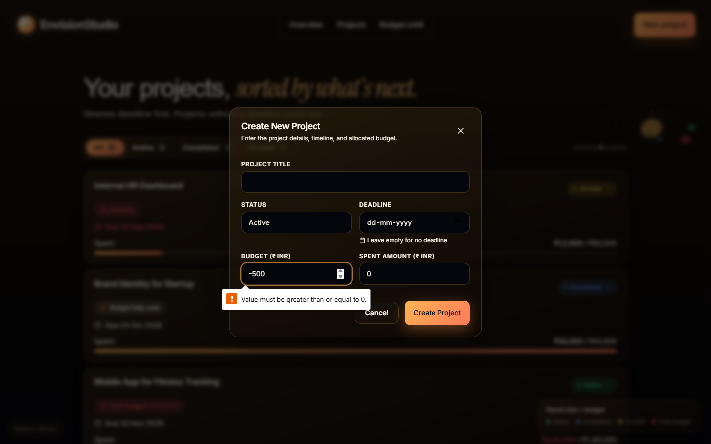
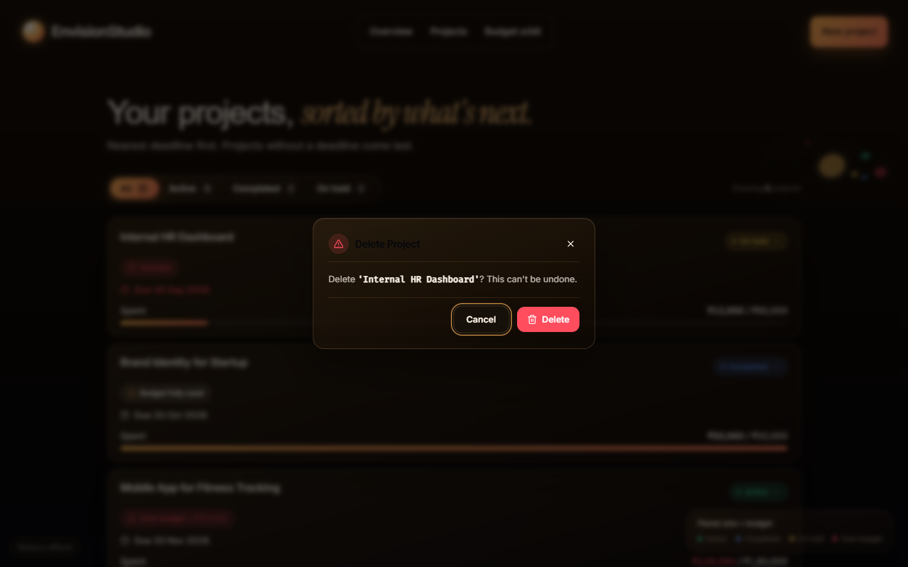
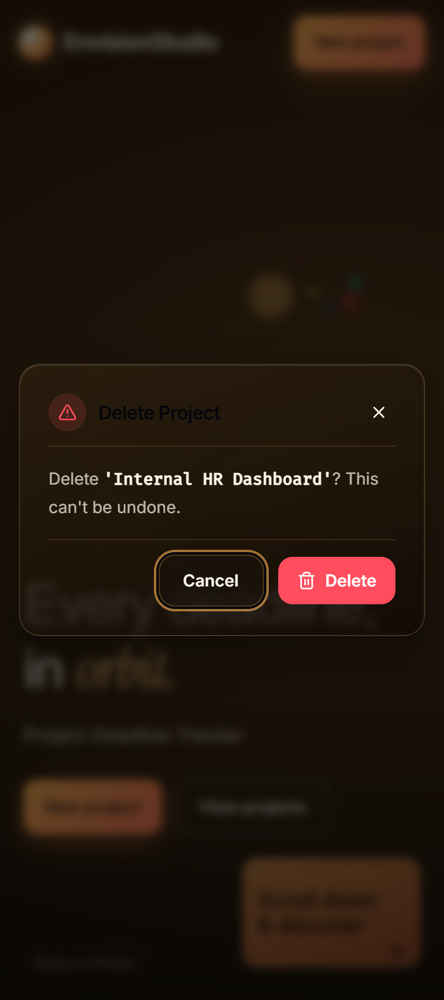
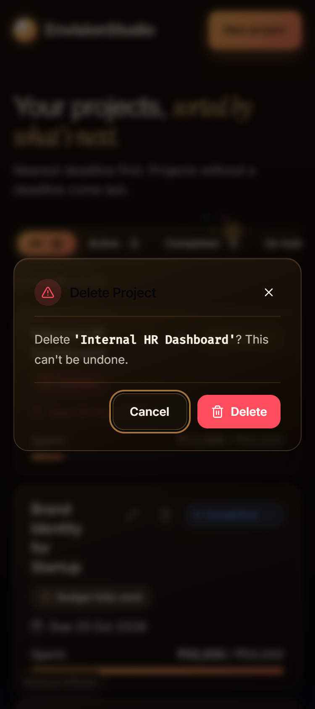

# Project Deadline Tracker

## 1. How to Run Locally

### Prerequisites
- **Node.js**: v18.0.0 or higher
- **npm**: v9.0.0 or higher

### Environment Variables & Ports
Both the server and client run out-of-the-box with zero configuration required. The default values are:
- **Server** (runs on `http://localhost:4000`):
  - `PORT=4000`
  - `DB_PATH=./data/projects.db`
  - `CLIENT_ORIGIN=http://localhost:5173,http://localhost:5174`
- **Client** (runs on `http://localhost:5173`, with automatic `/api` dev proxy to `http://localhost:4000`):
  - `VITE_API_URL=` (defaults to relative `/api/projects`)

### Exact Commands

1. **Install all dependencies** (root, server, and client):
   ```bash
   npm run install:all
   ```

2. **Start the application** (runs server on `:4000` and client on `:5173` concurrently):
   ```bash
   npm run dev
   ```
   Navigate to `http://localhost:5173/projects` in your browser.

3. **Run automated test suites** (server Supertest + client Vitest):
   ```bash
   npm test
   ```

4. **Build production bundles**:
   ```bash
   npm run build
   ```

### How Seeding Works
- The application uses SQLite `PRAGMA user_version` to track initialization.
- When the database file is first created (`user_version = 0`), the server automatically seeds the 5 initial assessment projects and advances `user_version` to 1.
- If all projects are deleted, restarting the server **never re-seeds**, keeping the database empty as expected.
- To manually reset or re-seed the database at any time:
   ```bash
   npm run seed
   ```
   *(Or force a clean wipe and re-seed: `npm --prefix server run seed -- --force`).*

---

### Output Screenshots & Detailed Walkthrough

#### 1. Desktop Dashboard & Cinematic Hero (1440×900)

*Figure 1: The Solar Gold desktop dashboard at 1440×900 viewport. Shows the fixed 4-layer scene stack, the ambient celestial sun and planetary orbit visualization, live navigation bar with active section indicators, and the prominent "+ New project" action button.*

#### 2. Project List, Live Badges & Card Actions

*Figure 2: The active project cards stack sorted by nearest deadline first with null deadlines last. Shows all business rule badge states:*
- **"Internal HR Dashboard"**: Overdue badge displayed because its deadline (`2026-09-30`) is in the past.
- **"Brand Identity for Startup"**: Completed project with exact budget spent, displaying the neutral "Budget fully used" badge.
- **"Mobile App for Fitness Tracking"**: Active project with over-budget warning badge (`+₹20,000`) and red progress bar fill.
- **"Portfolio Website"**: Project with no deadline showing the italic "No deadline" indicator and over-budget badge.
- **Card Action Buttons**: Each card features accessible 36px touch targets for inline Status Select, Edit (pencil), and Delete (trash).

#### 3. Add & Edit Project Modal with Server Validation

*Figure 3: Shared project form modal demonstrating real-time server error handling. Submitting invalid inputs (empty title, negative budget, invalid calendar date) preserves modal state, displays a top summary banner, and highlights each failing input with readable error messages.*

#### 4. Delete Confirmation Dialog

*Figure 4: Accessible glass confirmation dialog for destructive actions. Features trapped focus, initial focus on Cancel, double-click protection, and optimistic deletion with automatic rollback if an error occurs.*

#### 5. Mobile Responsive View (375×844)


*Figures 5 & 6: Mobile viewport rendering at 375×844. Verified with zero horizontal scroll (`scrollWidth === clientWidth`), touch-friendly targets (36px+), readable typography, and card action buttons always visible.*

#### 6. Live Video Walkthrough & Output Demo
An interactive video recording demonstrating the full end-to-end functionality of the Project Deadline Tracker:
- **Atmospheric Celestial 3D Orbit**: Three.js planetary visualization smoothly transforming with scroll velocity.
- **Dynamic Status Filtering**: Segmented tabs switching between All, Active, Completed, and On hold with live tab counts.
- **Real-Time Badge Computing**: Automatic calculation of overdue deadlines and budget overruns (`+₹20,000`).
- **Interactive Modals**: Form creation, inline editing, server error banners, and accessible delete confirmation.

▶️ **[Download / Watch Walkthrough Video (WebM)](screenshots/demo-walkthrough.webm)**

<video src="screenshots/demo-walkthrough.webm" width="100%" controls loop muted>
  Your browser does not support the video tag. <a href="screenshots/demo-walkthrough.webm">Click here to view or download the walkthrough video.</a>
</video>

---

## 2. Stack Choice

- **Backend (Node.js + Express + TypeScript)**: Delivers a clean, layered REST architecture (routes → controllers → services → validators) with end-to-end type safety.
- **Database (SQLite via better-sqlite3 with node:sqlite fallback)**: Zero-setup persistent file database with high-performance WAL mode and strict table-level `CHECK` constraints.
- **Validation (Zod)**: Acts as the single source of truth for runtime validation, guaranteeing non-empty trimmed titles, calendar-accurate dates, non-negative numbers, and structured HTTP 400 error payloads.
- **Frontend (React + Vite + TypeScript + Tailwind CSS)**: Sub-millisecond HMR, clean hook architecture (`useProjects`), accessible modals, and Solar Gold design system without bloated UI libraries.
- **Three.js (Optional Orbit Visual)**: Lightweight, lazy-loaded 3D visualization that renders as an optional decoration and never blocks or affects core app functionality; the app works completely without it.

Overdue status depends on today's date, so the live Overdue count changes as dates pass.
Edit and delete were added beyond the three required endpoints on purpose, because a real tracker needs them.

---

## 3. Decision 1 — Tasks Model

Option B (separate Task table with a projectId reference), because tasks will grow and need independent querying, updating and pagination without rewriting the whole project record.

---

## 4. Decision 2 — Sort Order

Nearest deadline first with null deadlines last, because a deadline tracker should surface the most time-critical work first.

---

## 5. Bug Hunt

Review of the buggy helper function:
```javascript
function isOverdue(project) {
  return new Date(project.deadline) < new Date();
}
```

- **Bug 1 (Timezone)**: A date-only string such as `"2026-12-15"` is parsed by ECMAScript as UTC midnight (`00:00:00Z`), while `new Date()` evaluates against current local time; consequently, the result shifts with the user's timezone and a project due today can be flagged wrongly.
- **Bug 2 (Missing Data)**: `new Date(null)` evaluates to the Unix Epoch (`1970-01-01`), so a null deadline is wrongly reported as overdue, and `new Date(undefined)` or an invalid string gives `Invalid Date`, where the comparison silently returns false and hides bad data; an explicit null/validity check is needed.

Spent amount equal to budget is within budget (budget fully used, not exceeded).


